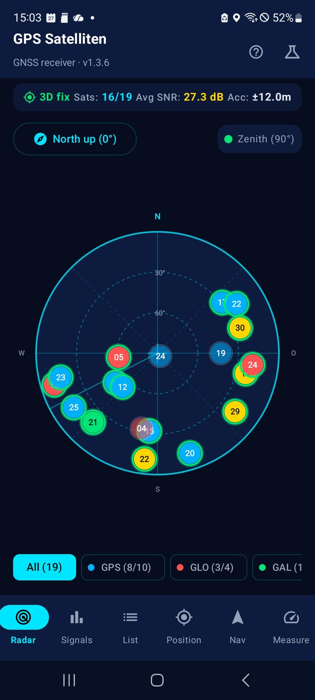
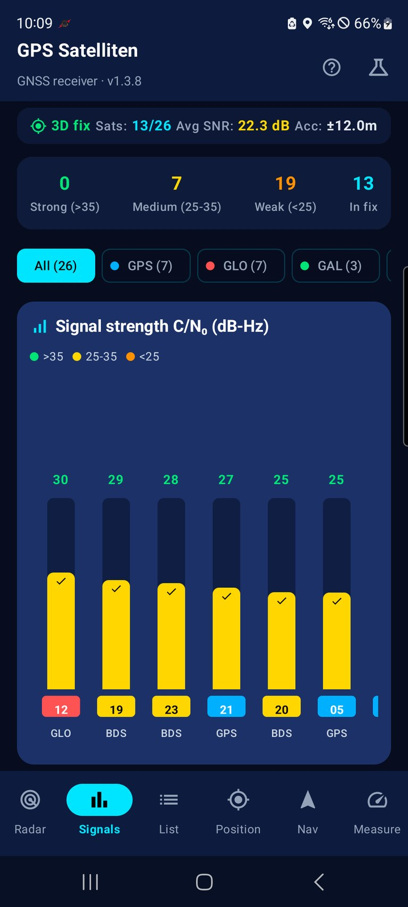
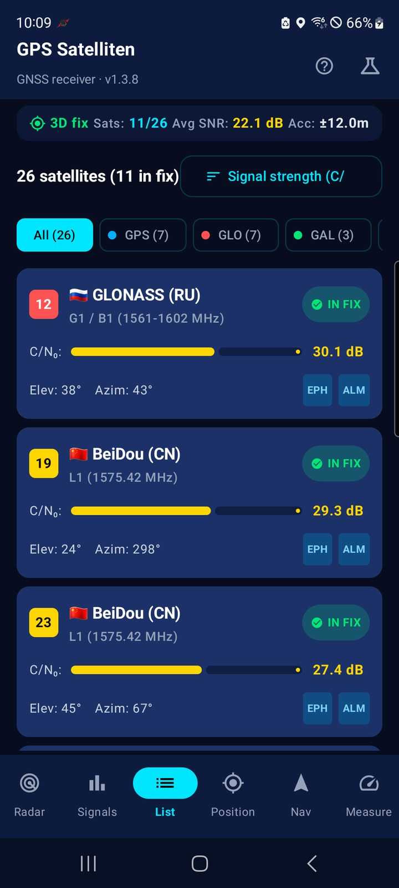
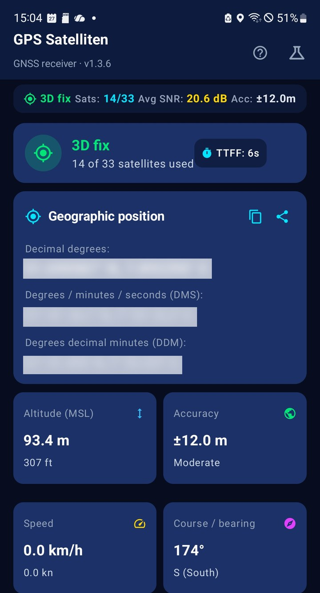
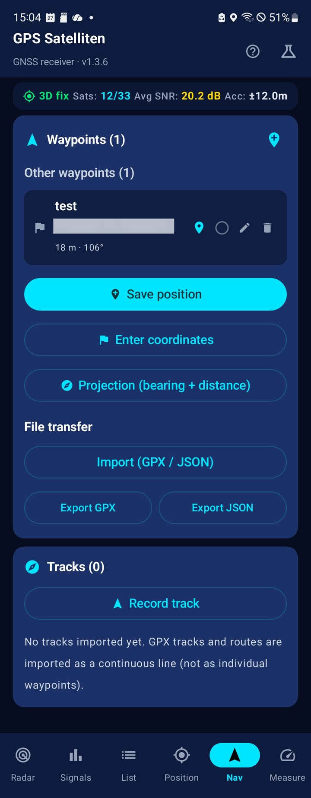
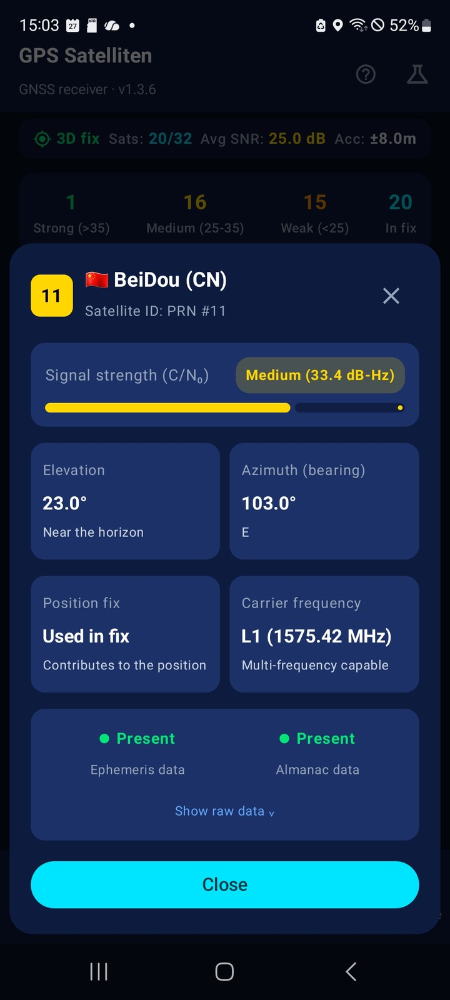
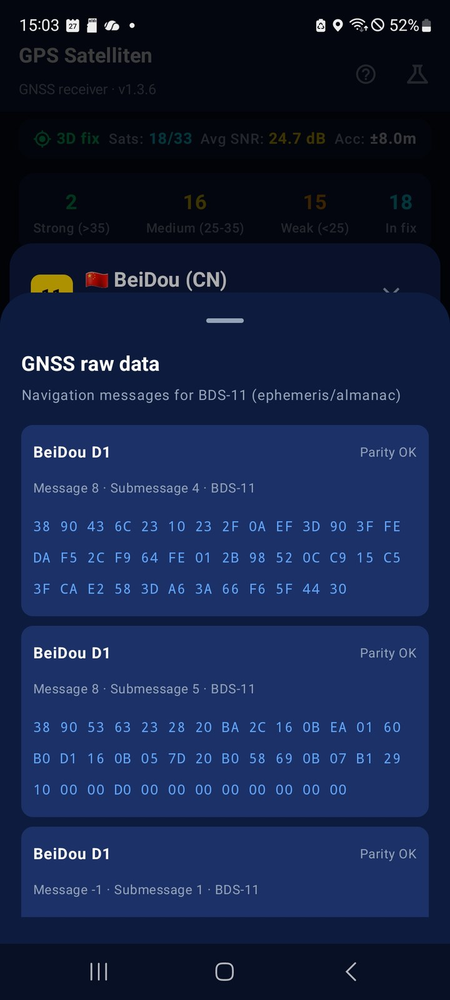
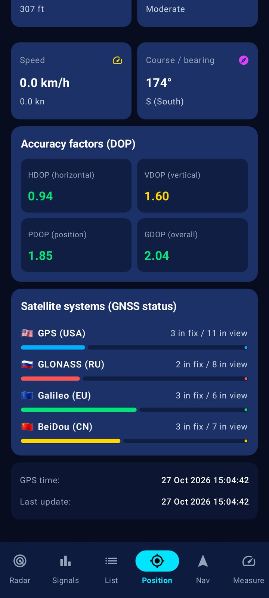
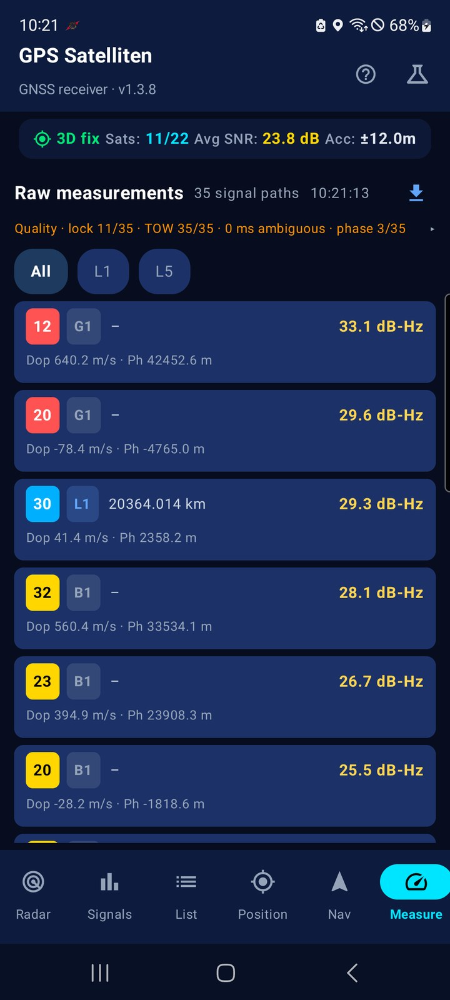
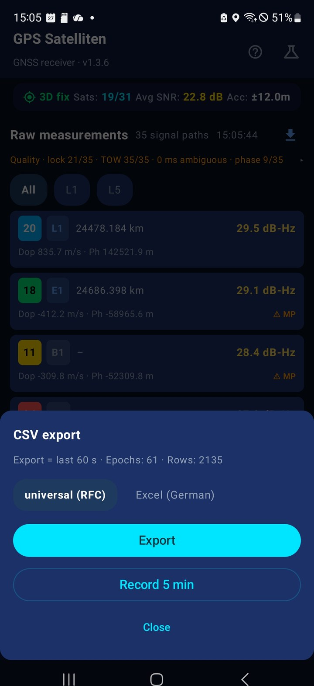

# GPS Satellites 📡

[Deutsch](README.md) · **English**

Native Android app (Kotlin + Jetpack Compose) for **live GNSS satellite display** – with sky radar, signal analysis, position readout and a **geocaching companion for the trail**. Runs completely offline, without ads and without passing any data on – reliable from an older phone up to the current flagship.

## Principles (verifiable, not just claimed)

- **No `INTERNET` permission.** The app is technically unable to open a connection to the outside – no tracking, no analytics, no hidden requests. Checkable in the manifest.
- **Pure GNSS, no hybrid.** Deliberately without Wi-Fi, cell-tower or fused-location positioning and without Google Play services – satellite positioning only, so the app really stays completely offline.
- **Tested in airplane mode.** Runs reliably and briskly on older devices without any connection.
- **~2 MB APK.** No map SDK, no analytics library. Maps open through `geo:` intents in an external app. *(Android shows ~11 MB after installation: it stores an additional machine-translated copy of the code. Every app gets that and it cannot be switched off.)*

## Download (ready-made APK) ⬇️

No desire to build it yourself? Just download the ready-made APK and install it directly:

- **[Latest version](https://github.com/Theo555/gps-satelliten/releases/latest)** – the current release (download the APK there)
- **[All releases](https://github.com/Theo555/gps-satelliten/releases)** – overview of every release

> **Note:** The APK is signed with a test key. On first installation a **Play Protect warning** may appear – simply choose **"Install anyway"**. This warning is normal for GitHub APKs and **no sign of malicious code** – it appears because the app is not distributed through the Play Store. Requirement: Android 7.0 (API 24) or newer.

## Features

### 🛰️ Live GNSS display

- Real-time capture of received satellites (**GPS, GLONASS, Galileo, BeiDou, QZSS, SBAS**)
- **Sky radar** – polar plot with elevation/azimuth, "North up" or "Compass up", animated radar sweep
- **Signal strength** – C/N₀ bar chart with quality colours and a summary
- **Satellite list** – sortable/filterable, with ephemeris/almanac status and carrier frequency

### 📡 GNSS raw data & measurement

- **Navigation messages** – ephemeris/almanac raw data per satellite as a hex view (in the satellite details)
- **Measurement tab** – per satellite and frequency band (**L1/L5/L2/E1/E5a/E5b**): C/N₀, **pseudorange**, Doppler, carrier phase and multipath detection
- **Honest display** – values the device does not deliver (e.g. pseudorange or clock drift) appear as "–" or "unknown" instead of an invented number
- **Raw data quality** – one line with code lock, TOW, ms ambiguity and carrier phase; tap to expand the details
- **CSV export** – the raw measurements as a **time series** (last 60 s, optionally a 5-minute recording), either RFC-compliant or for German Excel (details under [raw data export](#raw-data-export-csv))
- Note: The measurement tab only appears on devices that support **GNSS raw measurements** (`GnssMeasurements`).

### 📍 Position fix

- Coordinates in three formats: **decimal degrees, DMS and DDM** (geocaching standard)
- Accuracy, altitude (MSL), speed, course/bearing
- **DOP values** (HDOP/VDOP/PDOP/GDOP) – computed directly from the satellite geometry
- TTFF (time to first fix)

### 🗂️ Nav tab

- **Active target always on top** – the waypoint (or track) you are following, with distance, bearing and “Open in map”
- **Toolbar** – *Save position*, *Enter coordinates* and *Projection* in one tap
- **Four sections** – caches, other waypoints, tracks, files. Only one is open at a time, and the last one you opened is remembered
- **Recording stays visible** – while recording, the collapsed tracks header shows the point count and a stop button

### 🧭 Geocaching

- **Waypoints** with name, GC code, hint, difficulty/terrain (D/T) and cache type – visible right in the list (`GC600 · D2.0/T2.0 · 11.94 km`)
- **Cache groups** – a pocket query stays together: the cache and its additional waypoints (parking, stages) appear as one row with a count
- **Arrow navigation** to the active target (distance + bearing, relative to the viewing direction)
- **Mark as found** with one tap – the next unfound target then becomes active automatically
- **Projection** – compute a new waypoint from bearing + distance (for multis/mysteries)
- **Hint display** – hidden at first (spoiler protection); plain text after tapping, ROT13-decoded via the toggle
- **Import/export** – GPX (geocaching standard) and JSON through the Android file picker. Robust XML import from various sources (Pocket Query, GSAK, c:geo) with GC code, type, D/T and hint; broken entries are skipped and reported ("X imported, Y skipped")
- **"Open in map"** – hand a waypoint to an external map app via a `geo:` intent

**Deliberately not included**

- **No map inside the app.** Not on principle – map tiles cost storage and licensing – but because a map app does it better and is usually installed anyway: coordinates go there via a `geo:` intent (e.g. to OsmAnd, which also works offline).
- **No listing text, no logs, no spoiler images.** Those require fetching from geocaching.com with an account, which contradicts the offline approach. The hint – the part you actually need while searching – comes with the GPX file and is available offline.

### 🗺️ Tracks & recording

- **Import tracks/routes** – GPX tracks and routes as a continuous line
- **Follow a track** in the stored order (start at the beginning or at the nearest point)
- **Reverse a track** – walk the route backwards (e.g. back to the start)
- **Record your own trail** (breadcrumb) with pause/resume and rename; exportable as GPX (including altitude + timestamps)
- **Arrival alarm** – vibration as soon as you are closer than 5 m to the active target
- **Bearing arrow in the radar** – direction to the active target right in the sky radar

### ⚙️ Other

- **Simulation mode** – a realistic satellite scenario when no reception is available (e.g. indoors or in the emulator)
- **Screen stays on** – the display stays awake while a target/track is active or a recording is running
- **Share position** – current coordinates plus a Google Maps link through the Android share menu (the app itself opens no connection – the receiving app does that)
- Dark telemetry design

## Screenshots

All images are thumbnails – **click one** to open it at full size.

<table>
  <tr>
    <td align="center"><a href="screenshots/en/radar.jpg"></a><br /><sub>Radar · satellites in the sky</sub></td>
    <td align="center"><a href="screenshots/en/signal.jpg"></a><br /><sub>Signals · C/N₀ per satellite</sub></td>
    <td align="center"><a href="screenshots/en/liste.jpg"></a><br /><sub>List · sortable and filterable</sub></td>
    <td align="center"><a href="screenshots/en/position.jpg"></a><br /><sub>Position · coordinates in three formats</sub></td>
  </tr>
  <tr>
    <td align="center"><a href="screenshots/en/navigation.jpg"></a><br /><sub>Navigation · target with direction</sub></td>
    <td align="center"><a href="screenshots/en/liste-detail.jpg"></a><br /><sub>Details · signal, angles, ephemeris</sub></td>
    <td align="center"><a href="screenshots/en/liste-rohdaten.jpg"></a><br /><sub>Raw data · navigation messages</sub></td>
    <td align="center"><a href="screenshots/en/position-dop.jpg"></a><br /><sub>Accuracy · DOP values</sub></td>
  </tr>
  <tr>
    <td align="center"><a href="screenshots/en/messung.jpg"></a><br /><sub>Measurement · raw data per signal path</sub></td>
    <td align="center"><a href="screenshots/en/messung-export.jpg"></a><br /><sub>Export · CSV with two profiles</sub></td>
    <td></td>
    <td></td>
  </tr>
</table>

## Technology

| | |
|---|---|
| Language | Kotlin 2.2 |
| UI | Jetpack Compose (Material 3) |
| Architecture | MVVM (`ViewModel` + `StateFlow`) |
| GNSS | `GnssStatusCompat`, `GnssMeasurements`, `GnssNavigationMessage`, `LocationManager`, compass sensors |
| minSdk / targetSdk | 24 (Android 7.0) / 36 |
| Build | AGP 9.x, Gradle 9.3 (wrapper), R8 + resource shrinking |

## Requirements

- Android 7.0 (API 24) or newer – tested from older devices (e.g. Galaxy Note9) up to current flagships (e.g. S26 Ultra)
- Android Studio (recommended) **or** Gradle 9.3 + JDK 17 + Android SDK 36

> **Note:** Some features depend on the hardware. The **measurement tab** (GNSS raw data) and the **navigation messages** only appear if the device's GNSS chipset supports `GnssMeasurements` and `GnssNavigationMessage`; the constellations you can receive are device-specific as well. All other features (radar, signals, position, geocaching, tracks) run on every supported device.

## Building

```bash
# Set the SDK path (if not detected automatically)
echo "sdk.dir=/path/to/android-sdk" > local.properties

# Debug APK
./gradlew assembleDebug

# Release APK (minified, ~2 MB)
./gradlew assembleRelease
```

The release APK is then located at `app/build/outputs/apk/release/app-release.apk`.

> **Note on signing:** The release build needs a signing key (see `signingConfigs` in `app/build.gradle.kts`). For a Play Store release, create your **own** upload key and keep it safe – a key that lives in the project is meant for local tests only.

## Using it as a geocaching companion

1. Download a pocket query from geocaching.com as **GPX**.
2. Import it in the app under **Nav → Files → Import (GPX/JSON)**.
3. Tap a cache in the list to make it the **active target**.
4. Follow the **bearing arrow** (distance + bearing).
5. Show the hint via **"Show hint"** and pick the representation with the **plain text ⇄ ROT13** toggle. Mark the cache as **"found"**.
6. For multis/mysteries: use **projection** or add new waypoints **manually** (coordinates in decimal/DMS/DDM).

### Where the GPX files come from

The app never downloads anything itself – import is always a file step, which is what keeps it offline.

**Without signing up**
- **[Opencaching.de](https://www.opencaching.de)** – free geocaching platform. “Download as …” → *gpx* on the cache page, or a whole search result (up to 500 caches) as a ZIP – [instructions in the wiki](https://wiki.opencaching.de/index.php/Wie_erhalte_ich_eine_GPX-Datei%3F). When the server is under heavy load, some functions are blocked for guests – a free account helps then.

**With a free account (no premium needed)**
- **[geocaching.com](https://www.geocaching.com)** – “Download GPX” on the cache page: title, attributes, public additional waypoints such as parking coordinates, hint and the 20 most recent logs. That is exactly what the app reads, including description and cache groups.

**Whole areas (premium)**
- **Pocket query** on geocaching.com – up to 1000 caches in one file

**Tools that write GPX**
- **[c:geo](https://www.cgeo.org/)** (Android) – export your own lists as GPX, works without a network
- **[GSAK](https://gsak.net/)** (Windows) – manage pocket queries and export them as GPX

Please use the official download buttons: automated scraping (scripts, “page scrapers”) violates the platforms’ terms of service, and the cache data is licensed (Opencaching.de under Creative Commons).

## Creating your own tracks

Your own hiking/cycling routes are easy to create with **[BRouter](https://brouter.de/brouter-web)**: draw the route → export as **GPX** → import it in the app under **Nav → Files → Import (GPX/JSON)** and follow the route. Faster and without an account also works with **[GraphHopper Maps](https://graphhopper.com/maps/)**.

## Viewing and reusing tracks

Recorded tracks leave the app as **GPX** and can be opened anywhere GPX is read. A selection – all links checked (as of 10/2026):

| Purpose | Tool | Note |
|---|---|---|
| View, edit | **[gpx.studio](https://gpx.studio)** | Open source, computes in the browser – the file never leaves the device. Elevation profile, cut/join/reverse |
| View, analyse | **[GPSVisualizer](https://www.gpsvisualizer.com)** | Very powerful (profiles, statistics, conversion into many formats), but uploads the file |
| View in 3D | **[VisuGPX](https://www.visugpx.com)** | Account required to save |
| Quick look | **[onlinemapmaker](https://onlinemapmaker.com/de/gpx-online-file-viewer-view-gpx-data-on-map-get-elevation-profile/)** | Map + elevation profile, ad-funded |
| Offline on the desktop | **[GPXSee](https://www.gpxsee.org)** | Open source for Windows/macOS/Linux, fast |
| Convert | **[GPSBabel](https://www.gpsbabel.org)** | The classic for formats, runs offline |
| Offline on the phone | **[OsmAnd](https://f-droid.org/packages/net.osmand.plus/)** · **[Organic Maps](https://f-droid.org/packages/app.organicmaps/)** | Both from F-Droid, offline maps |
| Maps | **[OpenStreetMap](https://www.openstreetmap.org)** · **[OpenTopoMap](https://opentopomap.org)** | |
| Analysis | **[QGIS](https://qgis.org)** | Also useful for the CSV export of the raw measurements |

If you would rather not hand out your own neighbourhood: **gpx.studio**, **GPXSee**, **GPSBabel** and **QGIS** compute on your own device. **GPSVisualizer** and **VisuGPX** get the file on their server.

## Raw data export (CSV)

In the **measurement tab** the export card writes the raw measurements as CSV – one row per satellite, frequency band and epoch. The export automatically contains the **last 60 seconds** (ring buffer), i.e. a short time series instead of a single instant. For longer captures there is **"Record 5 min"**: the recording stops by itself and then offers the export. Meant for analysis with Excel, pandas, QGIS or gnuplot.

**Two profiles** – the characters are deliberately coupled, not freely combinable:

| Profile | Separator | Decimal mark | BOM | Fits |
|---|---|---|---|---|
| **universal (RFC)** | `,` | `.` | no | pandas, QGIS, gnuplot, R (RFC 4180) |
| **Excel (German)** | `;` | `,` | yes | German Excel – opens straight into columns |

German Excel separates lists with `;` and decimal numbers with `,`; an RFC file ends up entirely in column A there. Hence two fixed profiles instead of individual switches.

**Structure:** `#` comment lines with device, Android and app version, UTC timestamp and the meaning of the flags, followed by the header row and the measured values. Missing values stay empty – no `null`, no `–`. *(The comment keys are written in German by the app; the column names are language-neutral.)*

```text
# format = RFC 4180 · UTF-8 · CRLF · Trennzeichen Komma · Dezimalzeichen Punkt
# export_utc = 2026-10-25T12:33:07Z
# geraet = samsung SM-N960F · hardware qcom · board msm8998
# aufzeichnung = 60 Epochen · 2140 Zeilen · 1 Epoche = ein GnssMeasurementsEvent
# flags = state_flags: GnssMeasurement.getState() · code_lock/tow_known/msec_ambiguous: 1 ja, 0 nein
epoch,svid,constellation,band,freq_hz,cn0_dbhz,time_ns,full_bias_ns,bias_ns,drift_nsps,leap_s,week_offset_ns,t_tx_raw_ns,t_tx_ns,sv_time_unc_ns,pseudorange_m,doppler_mps,adr_m,adr_state,phase_unc_m,state_flags,code_lock,tow_known,msec_ambiguous,multipath
```

`epoch` numbers the measurement sets (1 = the oldest in the export); gaps mean the chip delivered nothing at that moment. `adr_m` is the **accumulated delta range** – relative to the start time, not an absolute carrier phase. `time_ns` is the receiver time, `t_tx_ns` the satellite's transmission time; `full_bias_ns`, `bias_ns`, `drift_nsps` and `leap_s` are the receiver clock.

**Reading it in:**

```python
import pandas as pd
df = pd.read_csv("rawdata_universal.csv", comment="#")
```

In Excel choose the **"Excel (German)"** profile and open the file directly – or import the universal file via *Data → From Text/CSV*.

**Cross-check:** the pseudorange can be recomputed from the timestamps –
`(time_ns − full_bias_ns − bias_ns − t_tx_ns) · 1e-9 · c ≈ pseudorange_m`.

**Limits, honestly:** `export_utc` is the device clock, not GNSS time. If the chipset reports no quality attributes, the flag columns stay at 0 – the app does not guess anything.

**More raw data from the device:** Android's **developer options** contain the switch "Force full GNSS measurements". With it the chip tracks fully all the time instead of going into power-saving mode – that yields more signals and more frequently set status bits. The price is **higher battery drain**, which is why the option is off by default; for an export it is worth enabling temporarily. How much it helps depends on the chipset. The app cannot toggle this system setting itself.

## Project structure

```
app/src/main/java/de/gpsradar/satellites/
├── gps/               GpsDataManager (GNSS status + compass) · RawGnssManager (raw measurements)
├── model/             Data models, DOP computation, coordinate parser, GPX/JSON codec
├── ui/                ViewModel + Compose screens and components
└── MainActivity.kt    App entry point with tab navigation
```

## Support

If you like the app and want to support its further development, a small voluntary donation is very welcome:
**[paypal.me/gps-satelliten](https://paypal.me/gps-satelliten)**

Every feature is fully usable without a donation – no ads, no tracking, no subscriptions.

## License

[MIT](LICENSE) © 2026 TK
