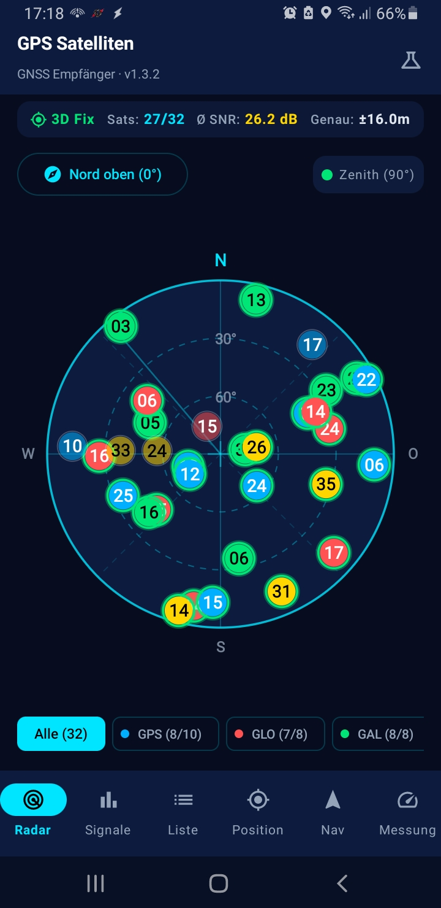
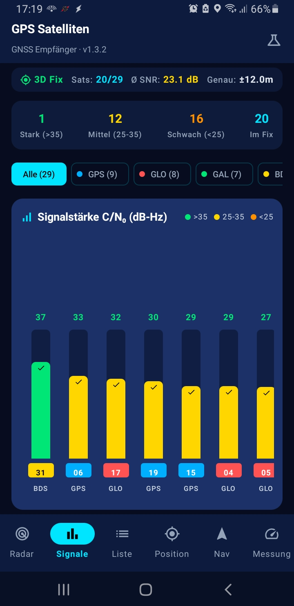
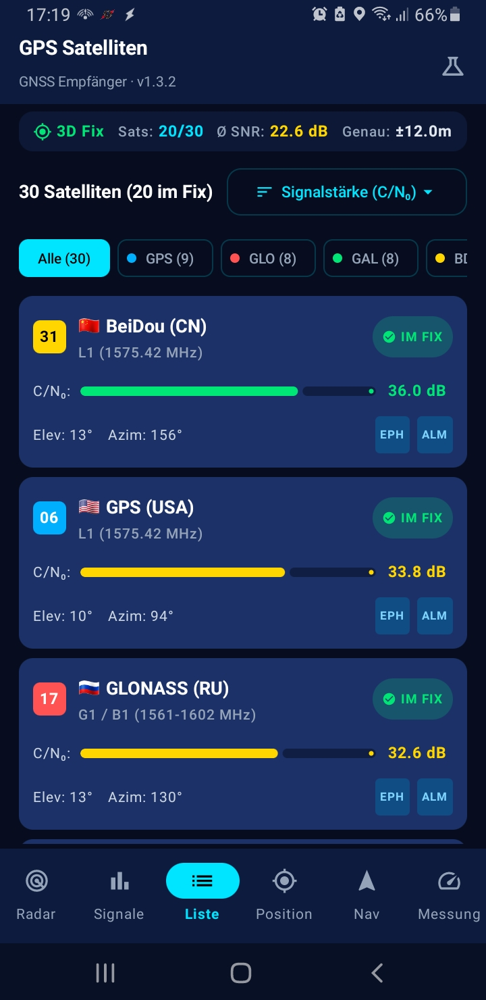
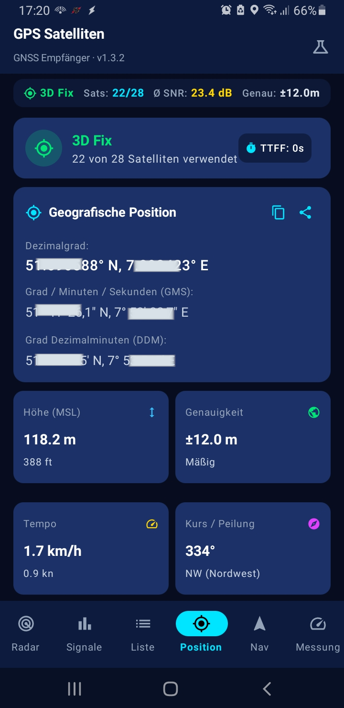
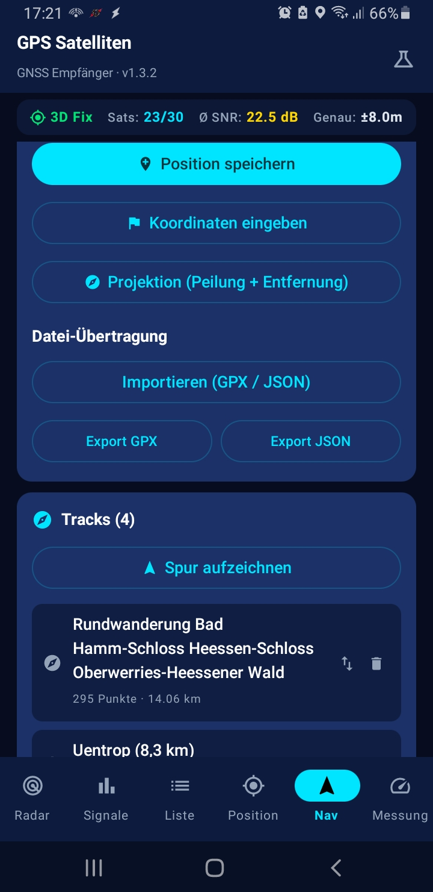
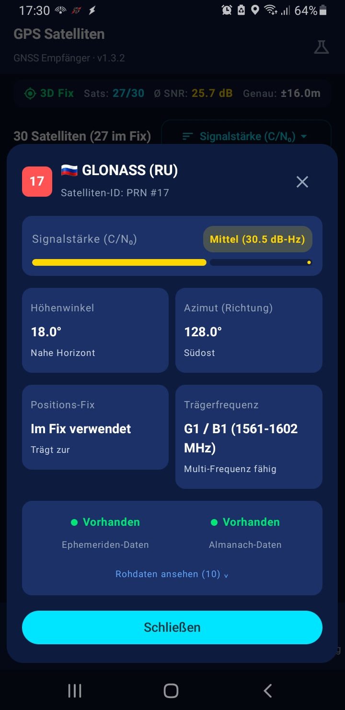
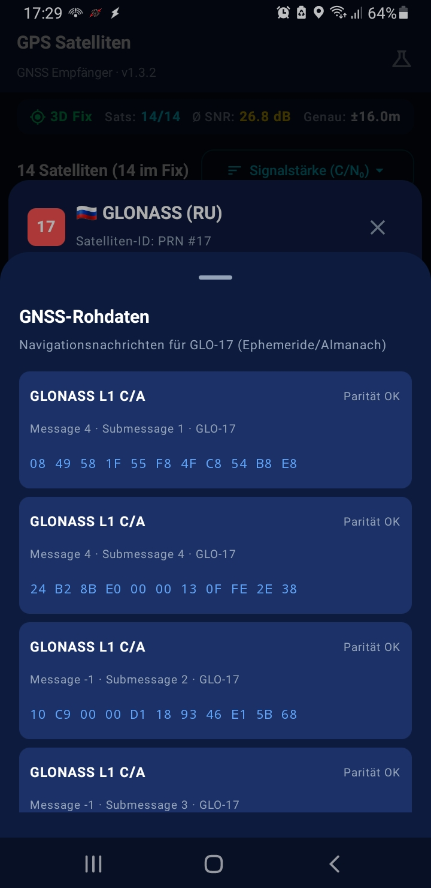
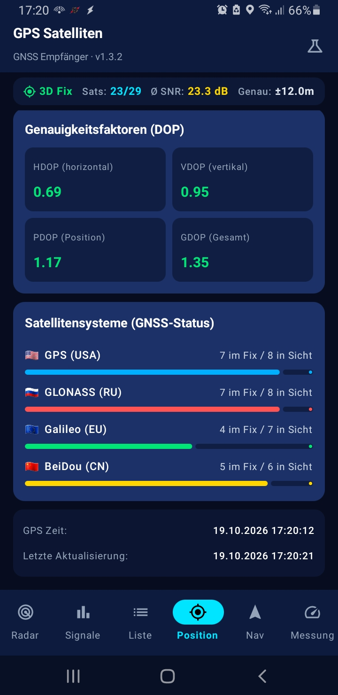

# GPS Satelliten 📡

Native Android-App (Kotlin + Jetpack Compose) zur **Live-Anzeige von GNSS-Satelliten** – mit Himmels-Radar, Signalanalyse, Positionsanzeige und vollwertigen **Geocaching-Funktionen**. Komplett offline nutzbar, ohne Werbung und ohne Datenweitergabe.

## Download (fertige APK) ⬇️

Keine Lust, selbst zu kompilieren? Lade einfach die fertige APK herunter und installiere sie direkt:

- **[Neueste Version](https://github.com/Theo555/gps-satelliten/releases/latest)** – das aktuelle Release (dort APK herunterladen)
- **[Alle Releases](https://github.com/Theo555/gps-satelliten/releases)** – Übersicht aller Releases

> **Hinweis:** Die APK ist mit einem Test-Schlüssel signiert. Beim ersten Installieren kann eine **Play-Protect-Warnung** erscheinen – dort einfach **„Trotzdem installieren"** wählen. Voraussetzung: Android 7.0 (API 24) oder neuer.

## Funktionen

### 🛰️ GNSS-Live-Anzeige

- Echtzeit-Erfassung empfangener Satelliten (**GPS, GLONASS, Galileo, BeiDou, QZSS, SBAS**)
- **Himmels-Radar** – Polarplot mit Elevation/Azimut, „Nord oben" oder „Kompass oben", animierter Radar-Sweep
- **Signalstärke** – C/N₀-Balkendiagramm mit Qualitätsfarben und Zusammenfassung
- **Satellitenliste** – sortier-/filterbar, mit Ephemeriden-/Almanach-Status und Trägerfrequenz

### � GNSS-Rohdaten & Messung

- **Navigationsnachrichten** – Ephemeriden-/Almanach-Rohdaten je Satellit als Hex-Ansicht (im Satelliten-Detail)
- **Messung-Tab** – pro Satellit und Frequenzband (**L1/L5/L2/E1/E5a/E5b**): C/N₀, **Pseudorange**, Doppler, Trägerphase und Multipfad-Erkennung
- Hinweis: Der Messung-Tab erscheint nur auf Geräten, die **GNSS-Roh-Messungen** (`GnssMeasurements`) unterstützen.

### �📍 Positionsbestimmung

- Koordinaten in drei Formaten: **Dezimalgrad, DMS und DDM** (Geocaching-Standard)
- Genauigkeit, Höhe (MSL), Geschwindigkeit, Kurs/Peilung
- **DOP-Werte** (HDOP/VDOP/PDOP/GDOP) – direkt aus der Satellitengeometrie berechnet
- TTFF (Time To First Fix)

### 🧭 Geocaching

- **Zielpunkte** mit Name, GC-Code, Hint (ROT13), Schwierigkeit/Gelände (D/T) und Cache-Typ
- **Pfeil-Navigation** zum aktiven Ziel (Entfernung + Peilung, relativ zur Blickrichtung)
- **Projektion** – neuen Zielpunkt aus Peilung + Entfernung berechnen (für Multis/Mysteries)
- **Hint-Anzeige** mit ROT13-Entschlüsselung (Spoiler-Schutz)
- **Import/Export** – GPX (Geocaching-Standard) und JSON über den Android-Datei-Picker, inkl. Pocket-Query-Support (GC-Code, Typ, D/T, Hint)
- **„In Karte öffnen"** – Zielpunkt per `geo:`-Intent an eine externe Karten-App übergeben

### 🗺️ Tracks & Aufzeichnung

- **Tracks/Routen importieren** – GPX-Tracks und -Routen als zusammenhängende Linie
- **Track folgen** in der gespeicherten Reihenfolge (Einstieg am Anfang oder am nächstgelegenen Punkt)
- **Track umkehren** – Route rückwärts ablaufen (z. B. zurück zum Start)
- **Eigene Spur aufzeichnen** (Breadcrumb) mit Pause/Fortsetzen und Umbenennen; als GPX exportierbar (inkl. Höhe + Zeitstempel)
- **Ankunfts-Alarm** – Vibration, sobald du dem aktiven Ziel näher als 5 m kommst
- **Peilungspfeil im Radar** – Richtung zum aktiven Ziel direkt im Himmels-Radar

### ⚙️ Sonstiges

- **Simulationsmodus** – realistisches Satelliten-Szenario, wenn kein Empfang verfügbar ist (z. B. in Gebäuden oder im Emulator)
- **Bildschirm bleibt an** – Display bleibt wach, solange ein Ziel/Track aktiv ist oder aufgezeichnet wird
- **Position teilen** – aktuelle Koordinaten inkl. Google-Maps-Link über das Android-Teilen-Menü
- Dunkles Telemetrie-Design

## Screenshots

<p align="center">
  
  
  
  
</p>

<p align="center">
  
  
  
  
</p>

## Technik

| | |
|---|---|
| Sprache | Kotlin 2.2 |
| UI | Jetpack Compose (Material 3) |
| Architektur | MVVM (`ViewModel` + `StateFlow`) |
| GNSS | `GnssStatusCompat`, `GnssMeasurements`, `GnssNavigationMessage`, `LocationManager`, Kompass-Sensoren |
| minSdk / targetSdk | 24 (Android 7.0) / 36 |
| Build | AGP 9.x, Gradle 9.3 (Wrapper), R8 + Ressourcen-Shrinking |

## Voraussetzungen

- Android 7.0 (API 24) oder neuer
- Android Studio (empfohlen) **oder** Gradle 9.3 + JDK 17 + Android SDK 36

## Bauen

```bash
# SDK-Pfad hinterlegen (falls nicht automatisch erkannt)
echo "sdk.dir=/pfad/zu/android-sdk" > local.properties

# Debug-APK
./gradlew assembleDebug

# Release-APK (minifiziert, ~2 MB)
./gradlew assembleRelease
```

Die Release-APK liegt danach unter `app/build/outputs/apk/release/app-release.apk`.

> **Hinweis zum Signieren:** Für den Release-Build wird ein Signatur-Key benötigt (siehe `signingConfigs` in `app/build.gradle.kts`). Für eine Play-Store-Veröffentlichung einen **eigenen** Upload-Key erstellen und sicher aufbewahren – ein im Projekt liegender Key ist nur für lokale Tests gedacht.

## Nutzung als Geocaching-Begleiter

1. Pocket-Query von geocaching.com als **GPX** herunterladen.
2. In der App unter **Nav → Importieren (GPX/JSON)** importieren.
3. Cache in der Liste antippen, um ihn zum **aktiven Ziel** zu machen.
4. Dem **Richtungspfeil** folgen (Entfernung + Peilung).
5. Hint über **„Hint anzeigen"** entschlüsseln, Cache als **„gefunden"** markieren.
6. Für Multis/Mysteries: **Projektion** nutzen oder neue Zielpunkte **manuell** anlegen (Koordinaten in Dezimal/DMS/DDM).

## Eigene Tracks erstellen

Eigene Wander-/Radrouten lassen sich bequem mit **[BRouter](https://brouter.de/brouter-web)** erstellen: Route zeichnen → als **GPX** exportieren → in der App unter **Nav → Importieren (GPX/JSON)** importieren und der Route folgen.

## Projektstruktur

```
app/src/main/java/de/gpsradar/satellites/
├── gps/               GpsDataManager (GNSS-Status + Kompass) · RawGnssManager (Roh-Messungen)
├── model/             Datenmodelle, DOP-Berechnung, Koordinaten-Parser, GPX/JSON-Codec
├── ui/                ViewModel + Compose-Screens und -Komponenten
└── MainActivity.kt    App-Einstieg mit Tab-Navigation
```

## Lizenz

[MIT](LICENSE) © 2026 GPS Satelliten contributors

