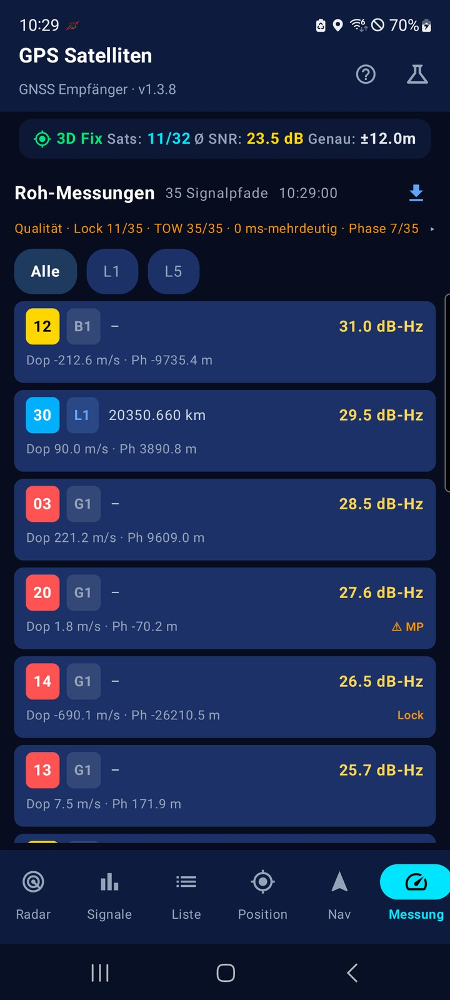
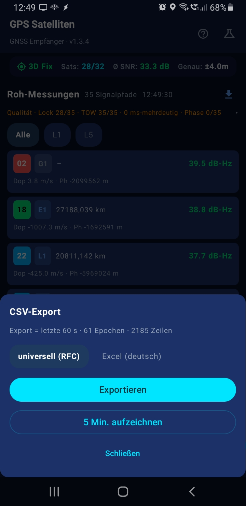

# GPS Satelliten 📡

**Deutsch** · [English](README.en.md)

Native Android-App (Kotlin + Jetpack Compose) zur **Live-Anzeige von GNSS-Satelliten** – mit Himmels-Radar, Signalanalyse, Positionsanzeige und einem **Geocaching-Begleiter für unterwegs**. Läuft komplett offline, ohne Werbung und ohne Datenweitergabe – zuverlässig vom älteren Smartphone bis zum aktuellen Flaggschiff.

## Prinzipien (prüfbar, nicht nur behauptet)

- **Keine `INTERNET`-Berechtigung.** Die App kann technisch keine Verbindungen nach außen aufbauen – kein Tracking, keine Analytics, keine versteckten Anfragen. Prüfbar im Manifest.
- **Rein GNSS, kein Hybrid.** Bewusst ohne WLAN-, Funkzellen- oder Fused-Location-Ortung und ohne Google Play Services – nur Satelliten-Ortung, damit die App tatsächlich komplett offline bleibt.
- **Im Flugmodus getestet.** Läuft sauber und flink auf älteren Geräten ohne jede Verbindung.
- **~2 MB APK.** Kein Karten-SDK, keine Analytics-Bibliothek. Karten öffnen über `geo:`-Intents in einer externen App. *(Android zeigt nach der Installation ~11 MB an: Es legt zusätzlich eine maschinell übersetzte Kopie des Codes ab. Das macht es mit jeder App und lässt sich nicht abschalten.)*

## Download (fertige APK) ⬇️

Keine Lust, selbst zu kompilieren? Lade einfach die fertige APK herunter und installiere sie direkt:

- **[Neueste Version](https://github.com/Theo555/gps-satelliten/releases/latest)** – das aktuelle Release (dort APK herunterladen)
- **[Alle Releases](https://github.com/Theo555/gps-satelliten/releases)** – Übersicht aller Releases

> **Hinweis:** Die APK ist mit einem Test-Schlüssel signiert. Beim ersten Installieren kann eine **Play-Protect-Warnung** erscheinen – dort einfach **„Trotzdem installieren"** wählen. Diese Warnung ist bei GitHub-APKs normal und **kein Hinweis auf Schadcode** – sie erscheint, weil die App nicht über den Play Store verteilt wird. Voraussetzung: Android 7.0 (API 24) oder neuer.

## Funktionen

### 🛰️ GNSS-Live-Anzeige

- Echtzeit-Erfassung empfangener Satelliten (**GPS, GLONASS, Galileo, BeiDou, QZSS, SBAS**)
- **Himmels-Radar** – Polarplot mit Elevation/Azimut, „Nord oben" oder „Kompass oben", animierter Radar-Sweep
- **Signalstärke** – C/N₀-Balkendiagramm mit Qualitätsfarben und Zusammenfassung
- **Satellitenliste** – sortier-/filterbar, mit Ephemeriden-/Almanach-Status und Trägerfrequenz

### 📡 GNSS-Rohdaten & Messung

- **Navigationsnachrichten** – Ephemeriden-/Almanach-Rohdaten je Satellit als Hex-Ansicht (im Satelliten-Detail)
- **Messung-Tab** – pro Satellit und Frequenzband (**L1/L5/L2/E1/E5a/E5b**): C/N₀, **Pseudorange**, Doppler, Trägerphase und Multipfad-Erkennung
- **Ehrliche Anzeige** – Werte, die das Gerät nicht liefert (z. B. Pseudorange oder Uhr-Drift), erscheinen als „–“ bzw. „unbekannt“ statt als Fantasiezahl
- **Rohdaten-Qualität** – eine Zeile mit Code-Lock, TOW, ms-Mehrdeutigkeit und Trägerphase; antippen klappt Details auf
- **CSV-Export** – die Roh-Messungen als **Zeitreihe** (letzte 60 s, optional 5 Minuten Aufzeichnung), wahlweise RFC-konform oder für deutsches Excel (Details unter [Rohdaten-Export](#rohdaten-export-csv))
- Hinweis: Der Messung-Tab erscheint nur auf Geräten, die **GNSS-Roh-Messungen** (`GnssMeasurements`) unterstützen.

### 📍 Positionsbestimmung

- Koordinaten in drei Formaten: **Dezimalgrad, DMS und DDM** (Geocaching-Standard)
- Genauigkeit, Höhe (MSL), Geschwindigkeit, Kurs/Peilung
- **DOP-Werte** (HDOP/VDOP/PDOP/GDOP) – direkt aus der Satellitengeometrie berechnet
- TTFF (Time To First Fix)

### 🗂️ Nav-Tab

- **Aktives Ziel immer oben** – der Zielpunkt (oder Track), dem du folgst, mit Entfernung, Peilung und „In Karte öffnen"
- **Symbolleiste** – *Position speichern*, *Koordinaten eingeben* und *Projektion* mit einem Tipp
- **Vier Abteilungen** – Caches, weitere Zielpunkte, Tracks, Dateien. Es ist immer nur eine offen, und die zuletzt geöffnete bleibt gemerkt
- **Aufzeichnung im Blick** – läuft eine Aufzeichnung, zeigt der zugeklappte Tracks-Kopf Punktzahl und einen Stopp-Knopf

### 🧭 Geocaching

- **Zielpunkte** mit Name, GC-Code, Hint, Schwierigkeit/Gelände (D/T) und Cache-Typ – direkt in der Liste sichtbar (`GC600 · D2.0/T2.0 · 11.94 km`)
- **Cache-Gruppen** – eine Pocket Query bleibt zusammen: Cache und Zusatzpunkte (Parkplatz, Stationen) erscheinen als eine Zeile mit Anzahl der Wegpunkte
- **Pfeil-Navigation** zum aktiven Ziel (Entfernung + Peilung, relativ zur Blickrichtung)
- **„Gefunden“ markieren** mit einem Tipp – danach wird automatisch der nächste nicht gefundene Zielpunkt aktiv
- **Projektion** – neuen Zielpunkt aus Peilung + Entfernung berechnen (für Multis/Mysteries)
- **Hint-Anzeige** – zunächst verborgen (Spoiler-Schutz); nach Antippen im Klartext, per Umschalter auch ROT13-entschlüsselt
- **Import/Export** – GPX (Geocaching-Standard) und JSON über den Android-Datei-Picker. Robuster XML-Import aus verschiedenen Quellen (Pocket Query, GSAK, c:geo) mit GC-Code, Typ, D/T und Hint; fehlerhafte Einträge werden übersprungen und gemeldet („X importiert, Y übersprungen“)
- **„In Karte öffnen“** – Zielpunkt per `geo:`-Intent an eine externe Karten-App übergeben

**Bewusst nicht enthalten**

- **Keine Karte in der App.** Nicht aus Prinzip – Kartenkacheln kosten Speicher und Lizenz – sondern weil eine Karten-App das besser kann und ohnehin meist installiert ist: Die Koordinaten gehen per `geo:`-Intent dorthin (z. B. an OsmAnd, das auch offline arbeitet).
- **Kein Listingtext, keine Logs, keine Spoilerbilder.** Die gibt es nur über einen Abruf bei geocaching.com mit Konto – das widerspricht dem Offline-Ansatz. Der Hint, der beim Suchen wirklich zählt, kommt aus der GPX-Datei mit und ist offline verfügbar.

### 🗺️ Tracks & Aufzeichnung

- **Tracks/Routen importieren** – GPX-Tracks und -Routen als zusammenhängende Linie
- **Track folgen** in der gespeicherten Reihenfolge (Einstieg am Anfang oder am nächstgelegenen Punkt)
- **Track umkehren** – Route rückwärts ablaufen (z. B. zurück zum Start)
- **Eigene Spur aufzeichnen** (Breadcrumb) mit Pause/Fortsetzen und Umbenennen; als GPX exportierbar (inkl. Höhe + Zeitstempel)
- **Ankunfts-Alarm** – Vibration, sobald du dem aktiven Ziel näher als 5 m kommst
- **Peilungspfeil im Radar** – Richtung zum aktiven Ziel direkt im Himmels-Radar

### ⚙️ Sonstiges

- **Simulationsmodus** – realistisches Satelliten-Szenario, wenn kein Empfang verfügbar ist (z. B. in Gebäuden oder im Emulator)
- **Bildschirm bleibt an** – Display bleibt wach, solange ein Ziel/Track aktiv ist oder aufgezeichnet wird
- **Position teilen** – aktuelle Koordinaten inkl. Google-Maps-Link über das Android-Teilen-Menü (die App selbst öffnet dabei keine Verbindung – das übernimmt die Ziel-App)
- Dunkles Telemetrie-Design

## Screenshots

Alle Bilder sind Vorschaubilder – **anklicken** öffnet das jeweilige Bild in voller Größe.

<table>
  <tr>
    <td align="center"><a href="screenshots/radar.jpg"></a><br /><sub>Radar · Satelliten am Himmel</sub></td>
    <td align="center"><a href="screenshots/signal.jpg"></a><br /><sub>Signale · C/N₀ je Satellit</sub></td>
    <td align="center"><a href="screenshots/liste.jpg"></a><br /><sub>Liste · sortier- und filterbar</sub></td>
    <td align="center"><a href="screenshots/position.jpg"></a><br /><sub>Position · Koordinaten in drei Formaten</sub></td>
  </tr>
  <tr>
    <td align="center"><a href="screenshots/navigation.jpg"></a><br /><sub>Navigation · Zielpunkt mit Richtung</sub></td>
    <td align="center"><a href="screenshots/liste-detail.jpg"></a><br /><sub>Details · Signal, Winkel, Ephemeride</sub></td>
    <td align="center"><a href="screenshots/liste-rohdaten.jpg"></a><br /><sub>Rohdaten · Navigationsnachrichten</sub></td>
    <td align="center"><a href="screenshots/position-dop.jpg"></a><br /><sub>Genauigkeit · DOP-Werte</sub></td>
  </tr>
  <tr>
    <td align="center"><a href="screenshots/messung.jpg"></a><br /><sub>Messung · Rohdaten je Signalpfad</sub></td>
    <td align="center"><a href="screenshots/messung-export.jpg"></a><br /><sub>Export · CSV mit zwei Profilen</sub></td>
    <td></td>
    <td></td>
  </tr>
</table>

## Technik

| | |
|---|---|
| Sprache | Kotlin 2.2 |
| UI | Jetpack Compose (Material 3) |
| Architektur | MVVM (`ViewModel` + `StateFlow`) |
| GNSS | `GnssStatusCompat`, `GnssMeasurements`, `GnssNavigationMessage`, `LocationManager`, Kompass-Sensoren |
| minSdk / targetSdk | 24 (Android 7.0) / 36 |
| Build | AGP 9.x, Gradle 9.3 (Wrapper), R8 + Ressourcen-Shrinking |

## Voraussetzungen

- Android 7.0 (API 24) oder neuer – getestet von älteren Geräten (z. B. Galaxy Note9) bis zu aktuellen Flaggschiffen (z. B. S26 Ultra)
- Android Studio (empfohlen) **oder** Gradle 9.3 + JDK 17 + Android SDK 36

> **Hinweis:** Einige Funktionen hängen von der Hardware ab. Der **Messung-Tab** (GNSS-Rohdaten) und die **Navigationsnachrichten** erscheinen nur, wenn der GNSS-Chipsatz des Geräts `GnssMeasurements` bzw. `GnssNavigationMessage` unterstützt; auch die empfangbaren Konstellationen sind gerätespezifisch. Alle übrigen Funktionen (Radar, Signale, Position, Geocaching, Tracks) laufen auf allen unterstützten Geräten.

## Bauen

```bash
# SDK-Pfad hinterlegen (falls nicht automatisch erkannt)
echo "sdk.dir=/pfad/zu/android-sdk" > local.properties

# Debug-APK
./gradlew assembleDebug

# Release-APK (minifiziert, ~2 MB)
./gradlew assembleRelease
```

Die Release-APK liegt danach unter `app/build/outputs/apk/release/app-release.apk`.

> **Hinweis zum Signieren:** Für den Release-Build wird ein Signatur-Key benötigt (siehe `signingConfigs` in `app/build.gradle.kts`). Für eine Play-Store-Veröffentlichung einen **eigenen** Upload-Key erstellen und sicher aufbewahren – ein im Projekt liegender Key ist nur für lokale Tests gedacht.

## Nutzung als Geocaching-Begleiter

1. Pocket-Query von geocaching.com als **GPX** herunterladen.
2. In der App unter **Nav → Dateien → Importieren (GPX/JSON)** importieren.
3. Cache in der Liste antippen, um ihn zum **aktiven Ziel** zu machen.
4. Dem **Richtungspfeil** folgen (Entfernung + Peilung).
5. Hint über **„Hint anzeigen"** einblenden und mit dem Umschalter **Klartext ⇄ ROT13** die passende Darstellung wählen. Cache als **„gefunden"** markieren.
6. Für Multis/Mysteries: **Projektion** nutzen oder neue Zielpunkte **manuell** anlegen (Koordinaten in Dezimal/DMS/DDM).

### Woher die GPX-Dateien kommen

Die App lädt selbst nichts nach – der Import ist immer ein Dateischritt, damit sie offline bleibt. Gängige Quellen:

- **Pocket Query** bei geocaching.com – die klassische Quelle für ganze Gebiete (Premium-Konto nötig)
- **Opencaching.de** – unabhängige, kostenlose Plattform mit GPX-Export
- **c:geo** (Android) – eigene Listen als GPX ausgeben, auch ohne Netz
- **GSAK** (Windows) – Pocket Queries verwalten und als GPX ausgeben

## Eigene Tracks erstellen

Eigene Wander-/Radrouten lassen sich bequem mit **[BRouter](https://brouter.de/brouter-web)** erstellen: Route zeichnen → als **GPX** exportieren → in der App unter **Nav → Dateien → Importieren (GPX/JSON)** importieren und der Route folgen. Schneller und ohne Konto geht es auch mit **[GraphHopper Maps](https://graphhopper.com/maps/)**.

## Tracks ansehen und weiterverwenden

Aufgezeichnete Tracks gehen als **GPX** raus und lassen sich überall öffnen, wo GPX gelesen wird. Eine Auswahl – alle Links geprüft (Stand 10/2026):

| Zweck | Werkzeug | Hinweis |
|---|---|---|
| Ansehen, bearbeiten | **[gpx.studio](https://gpx.studio)** | Open Source, rechnet im Browser – die Datei verlässt das Gerät nicht. Höhenprofil, schneiden/verbinden/umdrehen |
| Ansehen, auswerten | **[GPSVisualizer](https://www.gpsvisualizer.com)** | Sehr mächtig (Profile, Statistiken, Umrechnung in viele Formate), lädt die Datei aber hoch |
| Ansehen mit 3D | **[VisuGPX](https://www.visugpx.com)** | Konto zum Speichern nötig |
| Schneller Blick | **[onlinemapmaker](https://onlinemapmaker.com/de/gpx-online-file-viewer-view-gpx-data-on-map-get-elevation-profile/)** | Karte + Höhenprofil, werbefinanziert |
| Offline am Rechner | **[GPXSee](https://www.gpxsee.org)** | Open Source für Windows/macOS/Linux, schnell |
| Umrechnen | **[GPSBabel](https://www.gpsbabel.org)** | Der Klassiker für Formate, läuft offline |
| Offline am Handy | **[OsmAnd](https://f-droid.org/packages/net.osmand.plus/)** · **[Organic Maps](https://f-droid.org/packages/app.organicmaps/)** | Beide aus F-Droid, Karten offline |
| Karten | **[OpenStreetMap](https://www.openstreetmap.org)** · **[OpenTopoMap](https://opentopomap.org)** | |
| Auswertung | **[QGIS](https://qgis.org)** | Ebenfalls praktisch für den CSV-Export der Rohmesswerte |

Wer die eigene Wohnumgebung nicht aus der Hand geben will: **gpx.studio**, **GPXSee**, **GPSBabel** und **QGIS** rechnen auf dem eigenen Gerät. **GPSVisualizer** und **VisuGPX** bekommen die Datei auf ihren Server.

## Rohdaten-Export (CSV)

Im **Messung-Tab** schreibt die Export-Karte die Roh-Messungen als CSV – eine Zeile pro Satellit, Frequenzband und Epoche. Der Export enthält automatisch die **letzten 60 Sekunden** (Ringpuffer), also eine kurze Zeitreihe statt nur einen Zeitpunkt. Für längere Aufnahmen gibt es **„5 Min. aufzeichnen“**: Die Aufzeichnung endet selbst und bietet dann den Export an. Gedacht für die Auswertung mit Excel, pandas, QGIS oder gnuplot.

**Zwei Profile** – die Zeichen sind bewusst gekoppelt, nicht frei kombinierbar:

| Profil | Trennzeichen | Dezimalzeichen | BOM | Passt zu |
|---|---|---|---|---|
| **universell (RFC)** | `,` | `.` | nein | pandas, QGIS, gnuplot, R (RFC 4180) |
| **Excel (deutsch)** | `;` | `,` | ja | deutschem Excel – öffnet direkt in Spalten |

Deutsches Excel trennt Listen mit `;` und Dezimalzahlen mit `,`; eine RFC-Datei landet dort komplett in Spalte A. Deshalb zwei feste Profile statt einzelner Schalter.

**Aufbau:** `#`-Kommentarzeilen mit Gerät, Android- und App-Version, UTC-Zeitpunkt und Bedeutung der Flags, darunter die Kopfzeile und die Messwerte. Fehlende Werte bleiben leer – kein `null`, kein `–`.

```text
# format = RFC 4180 · UTF-8 · CRLF · Trennzeichen Komma · Dezimalzeichen Punkt
# export_utc = 2026-10-25T12:33:07Z
# geraet = samsung SM-N960F · hardware qcom · board msm8998
# aufzeichnung = 60 Epochen · 2140 Zeilen · 1 Epoche = ein GnssMeasurementsEvent
# flags = state_flags: GnssMeasurement.getState() · code_lock/tow_known/msec_ambiguous: 1 ja, 0 nein
epoch,svid,constellation,band,freq_hz,cn0_dbhz,time_ns,full_bias_ns,bias_ns,drift_nsps,leap_s,week_offset_ns,t_tx_raw_ns,t_tx_ns,sv_time_unc_ns,pseudorange_m,doppler_mps,adr_m,adr_state,phase_unc_m,state_flags,code_lock,tow_known,msec_ambiguous,multipath
```

`epoch` nummeriert die Messsätze (1 = der älteste im Export); Lücken bedeuten, dass der Chip in dem Moment nichts geliefert hat. `adr_m` ist die **accumulated delta range** – relativ zum Startzeitpunkt, keine absolute Trägerphase. `time_ns` ist die Empfängerzeit, `t_tx_ns` die Sendezeit des Satelliten; `full_bias_ns`, `bias_ns`, `drift_nsps` und `leap_s` sind die Empfängeruhr.

**Einlesen:**

```python
import pandas as pd
df = pd.read_csv("rohdaten_universal.csv", comment="#")
```

In Excel das Profil **„Excel (deutsch)“** wählen und die Datei direkt öffnen – oder die universelle Datei über *Daten → Aus Text/CSV* importieren.

**Gegenprobe:** Die Pseudorange lässt sich aus den Zeitstempeln nachrechnen –
`(time_ns − full_bias_ns − bias_ns − t_tx_ns) · 1e-9 · c ≈ pseudorange_m`.

**Grenzen, ehrlich:** `export_utc` ist die Geräteuhr, nicht die GNSS-Zeit. Meldet der Chipsatz keine Qualitätsmerkmale, bleiben die Flag-Spalten bei 0 – die App schätzt nichts dazu.

**Mehr Rohdaten aus dem Gerät:** In den Android-**Entwickleroptionen** gibt es den Schalter „Vollst. GNSS-Messung erzwingen“. Damit trackt der Chip dauerhaft vollständig statt im Stromsparmodus – das bringt mehr Signale und häufiger gesetzte Status-Bits. Der Preis ist ein **höherer Akkuverbrauch**, deshalb ist die Option standardmäßig aus; für einen Export lohnt es sich, sie vorübergehend einzuschalten. Wie stark sie wirkt, hängt vom Chipsatz ab. Die App kann diese Systemeinstellung nicht selbst umschalten.

## Projektstruktur

```
app/src/main/java/de/gpsradar/satellites/
├── gps/               GpsDataManager (GNSS-Status + Kompass) · RawGnssManager (Roh-Messungen)
├── model/             Datenmodelle, DOP-Berechnung, Koordinaten-Parser, GPX/JSON-Codec
├── ui/                ViewModel + Compose-Screens und -Komponenten
└── MainActivity.kt    App-Einstieg mit Tab-Navigation
```

## Unterstützung

Wenn dir die App gefällt und du die Weiterentwicklung unterstützen möchtest, freue ich mich über eine kleine freiwillige Spende:
**[paypal.me/gps-satelliten](https://paypal.me/gps-satelliten)**

Alle Funktionen sind ohne Spende vollständig nutzbar – keine Werbung, kein Tracking, keine Abos.

## Lizenz

[MIT](LICENSE) © 2026 TK

